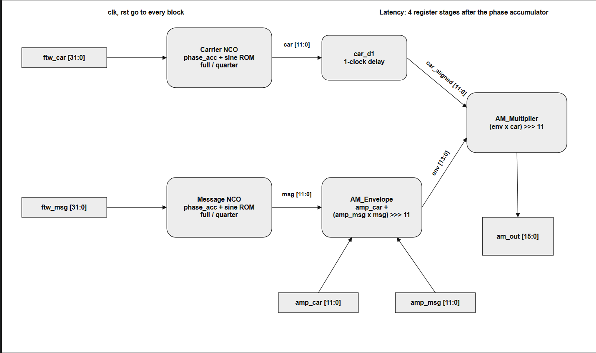
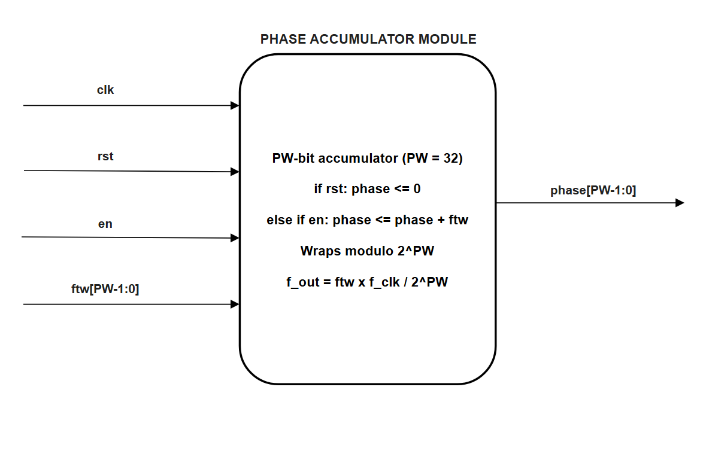
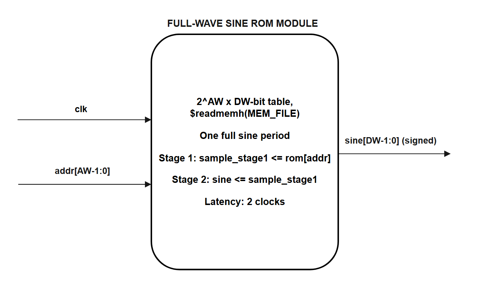
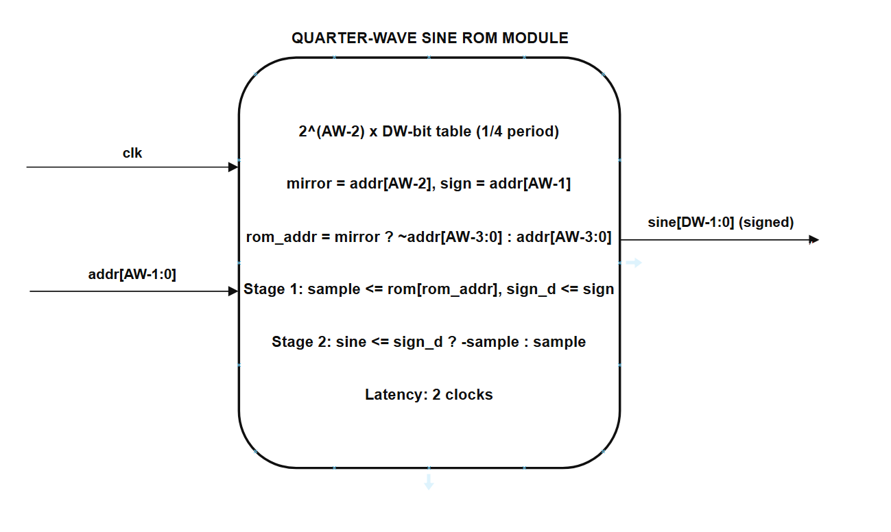
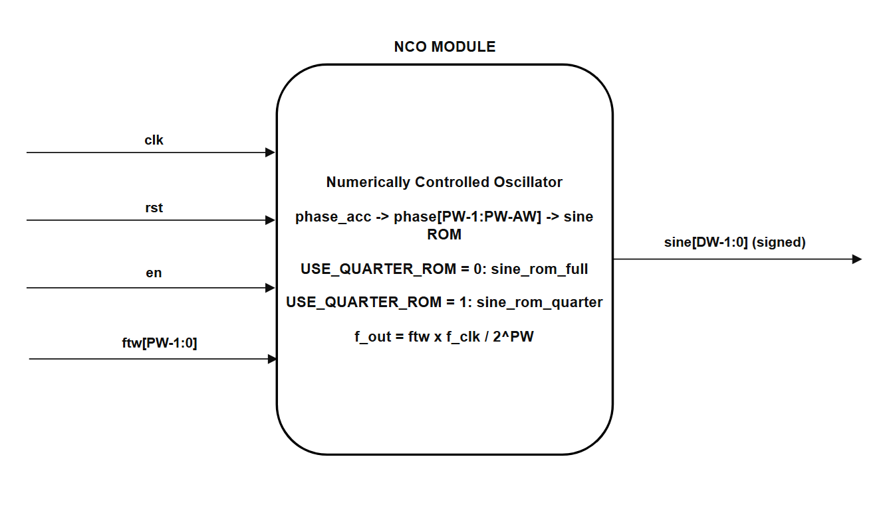
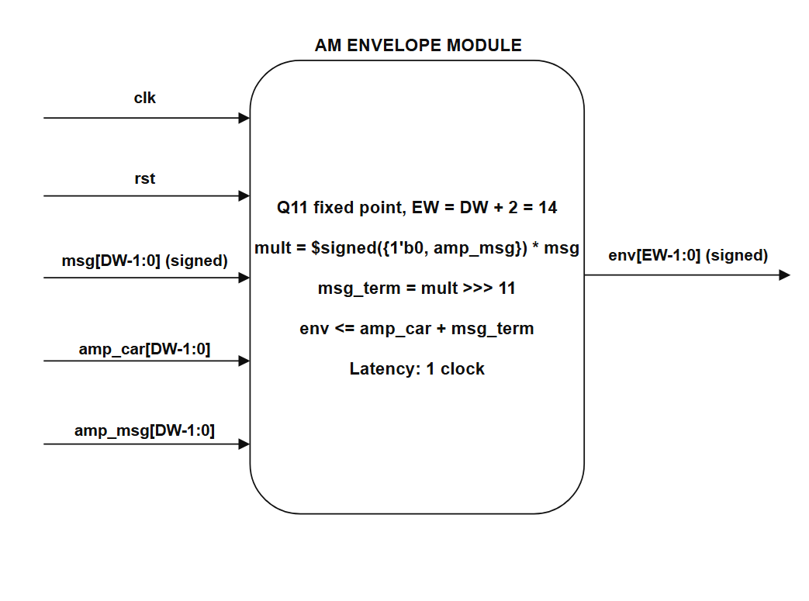
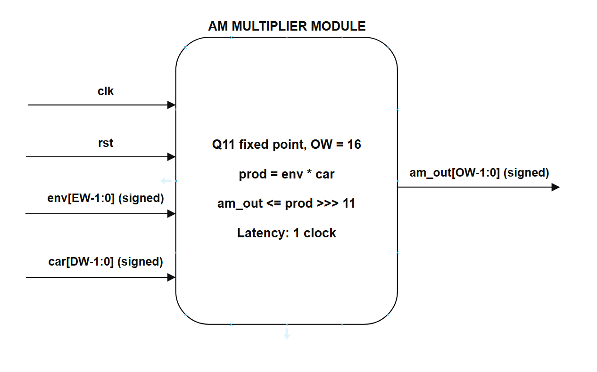
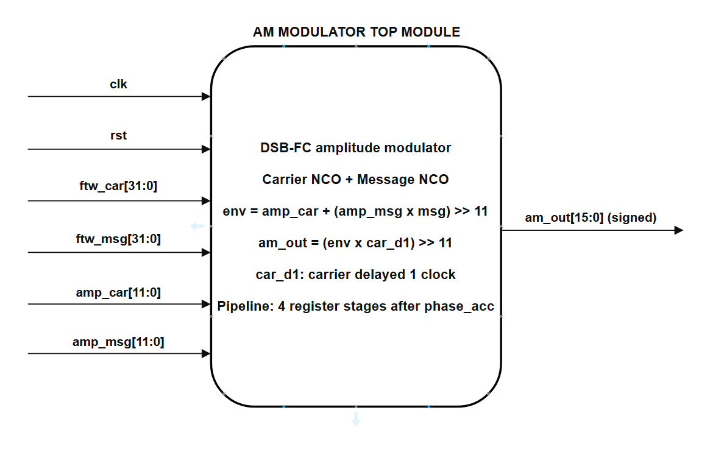
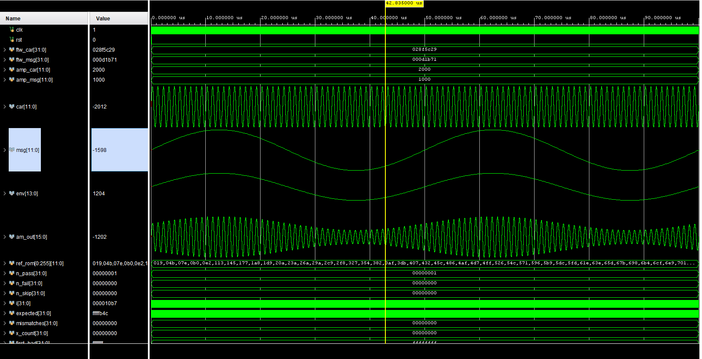
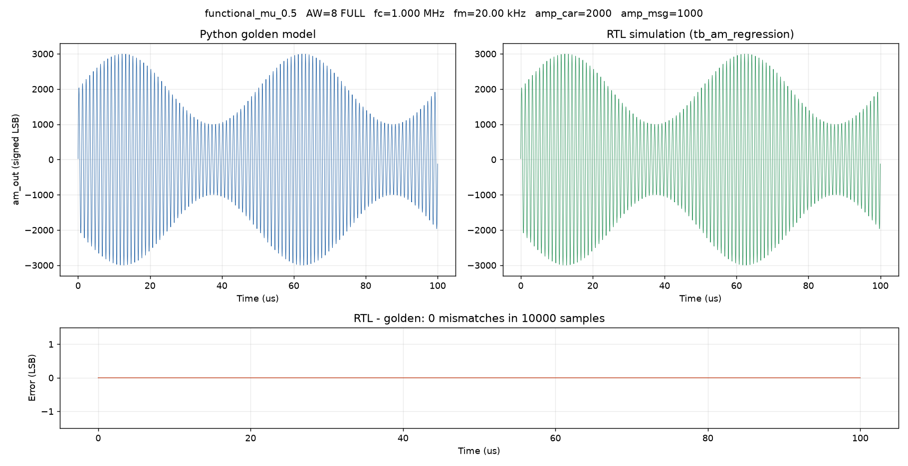

# AM Modulator — Verilog RTL Project

A fully pipelined **amplitude modulator (DSB-FC)** in Verilog, built around two hand-written numerically
controlled oscillators (NCOs). It compares a **full-wave** and a **quarter-wave** sine ROM at three table sizes,
verifies the RTL bit-for-bit against a Python golden model, and reports Vivado resource and timing results for
every configuration.

| | |
|---|---|
| Design | 7 RTL modules, 32-bit phase accumulators, 12-bit sine tables, Q11 fixed-point datapath, 16-bit signed output |
| Self-checking testbench | **7 / 7** checks pass in Vivado XSIM (`tb_am_top`), see [Section 8.1](#81-testbenches) |
| Golden model | **18 / 18** regression cases bit-exact (10 000 samples each), plus custom runs, see [Section 8.3](#83-regression-results) |
| Arithmetic | Overflow impossible for every legal input, proven exhaustively, see [Section 6](#6-datapath-and-pipeline) |
| Spectral purity | SFDR 48.1 / 60.7 / 71.9 dB for AW = 8 / 10 / 12, identical for full and quarter ROM, see [Section 10](#10-spectral-results) |
| Synthesis | Vivado 2020.2, Artix-7 `xc7a35tcpg236-1`, 100 MHz, see [Section 9](#9-synthesis-results) |

---

## Table of Contents

1. [Quick Start](#1-quick-start)
2. [System Overview](#2-system-overview)
3. [Block Diagram](#3-block-diagram)
4. [Repository Structure](#4-repository-structure)
5. [Module Index](#5-module-index)
6. [Datapath and Pipeline](#6-datapath-and-pipeline)
7. [Interface Specifications](#7-interface-specifications)
8. [Verification](#8-verification)
9. [Synthesis Results](#9-synthesis-results)
10. [Spectral Results](#10-spectral-results)
11. [Limitations](#11-limitations)
12. [Future Work](#12-future-work)
13. [References](#13-references)
14. [License](#14-license)

---

## 1. Quick Start

```bash
git clone https://github.com/Ygbzyem/AM-Modulation.git
cd AM-Modulation
pip install -r requirements.txt          # numpy, matplotlib, openpyxl
python -m unittest discover -s tests     # 24 tests -> OK
```

You need **Python 3.8+** and **Vivado 2020.2**. Keep the repository in a folder whose path contains only ASCII
characters; Vivado cannot open project paths with accented characters.

Everything runs from the Vivado GUI, with Python only for the comparison afterwards:

```text
Vivado: tb_am_top             -> RESULT: 7/7 PASS in the Tcl console
Vivado: tb_am_regression      -> python golden_model/verify_rtl.py    -> results/rtl/
Vivado: tb_am_top_filebased   -> python golden_model/check_result.py  -> results/custom/
Vivado: synthesis loop        -> results/synth/<config>/*.rpt
                                 python golden_model/make_excel.py    -> results/results.xlsx
```

The full guide, including the one-time project setup, the waveform view and the synthesis loop, is in
**[docs/SIMULATION.md](docs/SIMULATION.md)**.

---

## 2. System Overview

Amplitude modulation multiplies a high-frequency carrier by an envelope that follows the message:

$$
s(t) = A_c \left[1 + \mu \sin(2\pi f_m t)\right] \sin(2\pi f_c t), \qquad \mu = \frac{A_m}{A_c}
$$

The spectrum holds the carrier at $f_c$ and two sidebands at $f_c \pm f_m$, each with amplitude $\mu A_c / 2$.
With $\mu \le 1$ the envelope never crosses zero (DSB-FC); with $\mu > 1$ the signal is overmodulated; with
$A_c = 0$ only the sidebands remain (DSB-SC).

The design builds this signal in three stages, all in integer arithmetic:

1. **Two NCOs** generate the carrier and the message. Each is a 32-bit phase accumulator (`phase += FTW` every
   clock) whose top `AW` bits address a sine table. The output frequency is
   $f = \text{FTW} \cdot f_\text{clk} / 2^{32}$, a resolution of 0.023 Hz at 100 MHz.
2. **The envelope** `env = amp_car + (amp_msg · msg) >> 11` is formed from the message sample.
3. **The multiplier** produces `am_out = (env · car) >> 11`.

Every stage is registered, so the critical path is a single multiply. Carrier frequency, message frequency and
both amplitudes are run-time inputs; the table size `AW` and the ROM architecture are elaboration-time
parameters.

**Full-wave vs quarter-wave ROM.** A full-wave ROM stores one complete sine period ($2^{AW}$ words). A
quarter-wave ROM stores only the first quarter ($2^{AW-2}$ words) and rebuilds the rest from the symmetry of the
sine: one address bit mirrors the address, the other negates the output. It needs a quarter of the memory at the
cost of a little extra logic. Both architectures produce **identical samples** at every address; the trade-off
is purely in hardware cost ([Section 9](#9-synthesis-results)).

---

## 3. Block Diagram



*Data flow: `ftw_car` → carrier NCO (`phase_acc` → sine ROM, 2 stages) → `car_d1` (1-clock delay) →
`am_multiplier`; `ftw_msg` → message NCO → `am_envelope` (with `amp_car`, `amp_msg`) → `am_multiplier` →
`am_out`. `clk` and `rst` go to every block. The block diagram of each module is in
[Section 7](#7-interface-specifications); the editable source of all diagrams is
[image/block_diagrams.drawio](image/block_diagrams.drawio).*

---

## 4. Repository Structure

```
.
├── src/                          # synthesizable RTL
│   ├── am_modulator_top.v        #   top level: two NCOs, envelope, carrier delay, multiplier
│   ├── nco.v                     #   phase accumulator + selectable sine ROM
│   ├── phase_acc.v               #   32-bit phase accumulator
│   ├── sine_rom_full.v           #   full-wave sine table, 2 register stages
│   ├── sine_rom_quarter.v        #   quarter-wave sine table with mirror/negate, 2 stages
│   ├── am_envelope.v             #   amp_car + (amp_msg * msg) >> 11
│   └── am_multiplier.v           #   (env * car) >> 11
├── tb/                           # testbenches
│   ├── tb_am_top.v               #   self-checking, 7 checks, live demo
│   ├── tb_am_top_filebased.v     #   one configuration from am_config.txt, writes am_out.txt
│   ├── tb_am_regression.v        #   all 18 cases in one run, writes rtl_case01..18.txt
│   ├── am_config.txt             #   stimulus for tb_am_top_filebased (edit and rerun)
│   └── tb_am_top_behav.wcfg      #   Vivado waveform layout for the demo
├── golden_model/                 # Python reference model and comparison tools
│   ├── am_golden.py              #   bit-exact integer model of the datapath
│   ├── gen_sine_rom.py           #   generates mem/*.mem
│   ├── spectrum.py               #   FFT, SFDR and sideband measurement
│   ├── verify_rtl.py             #   RTL vs golden for the 18 regression cases + figures
│   ├── check_result.py           #   RTL vs golden for one tb_am_top_filebased run
│   ├── make_excel.py             #   builds results/results.xlsx
│   └── vivado_reports.py, ...    #   report parser and helpers
├── mem/                          # sine tables, AW = 8/10/12, full and quarter, + manifest.json
├── constraint/constraints.xdc    # 100 MHz clock, false paths on quasi-static inputs
├── tests/                        # 24 Python unit tests
├── results/
│   ├── rtl/                      #   RTL vs golden: RTL_VERIFICATION.md, one folder per case
│   ├── custom/                   #   RTL vs golden for each custom tb_am_top_filebased run
│   ├── sim/                      #   Vivado waveform screenshots
│   ├── synth/                    #   utilization, timing and power reports, 6 configurations
│   └── results.xlsx              #   everything above in one workbook
├── image/                        # block diagrams: system, 7 modules, editable .drawio source
├── docs/
│   ├── SIMULATION.md             #   simulation and synthesis guide
│   ├── am_modulator_top.md       #   datapath, pipeline and fixed-point notes
│   ├── DGT201_IC2010_Group3 - Project Report.pdf   # project report (Vietnamese, submitted version)
│   ├── report/                   #   project report (English): main.tex, main.pdf, figures, tables
│   └── slides/                   #   presentation
├── requirements.txt
├── LICENSE
└── README.md
```

---

## 5. Module Index

| # | Module | File | Role |
|---|--------|------|------|
| 1 | `phase_acc` | `phase_acc.v` | `PW`-bit accumulator, `phase <= phase + ftw` when `en` is high. Wraps modulo $2^{PW}$, which sets the output frequency. |
| 2 | `sine_rom_full` | `sine_rom_full.v` | $2^{AW}$ × 12-bit sine table loaded with `$readmemh`. Two output registers, latency 2 clocks. |
| 3 | `sine_rom_quarter` | `sine_rom_quarter.v` | $2^{AW-2}$ × 12-bit table. Mirrors the address in the second and fourth quadrant and negates the sample in the second half. Same 2-clock latency. |
| 4 | `nco` | `nco.v` | `phase_acc` followed by the ROM selected with `USE_QUARTER_ROM`; the top `AW` phase bits form the ROM address. |
| 5 | `am_envelope` | `am_envelope.v` | `env = amp_car + ((amp_msg · msg) >>> 11)`, registered. `amp_msg` is zero-extended before the signed multiply. |
| 6 | `am_multiplier` | `am_multiplier.v` | `am_out = (env · car) >>> 11`, registered, 16-bit signed. |
| 7 | `am_modulator_top` | `am_modulator_top.v` | Instantiates the carrier and message NCOs, the envelope and the multiplier, and delays the carrier one clock (`car_d1`) to meet the registered envelope. |

---

## 6. Datapath and Pipeline

**Sine tables.** Every entry is $\text{rom}[k] = \text{round}\left(2047 \sin\left(2\pi (k + 0.5) / 2^{AW}\right)\right)$,
12-bit two's complement (Q11). The half-sample offset makes the table exactly symmetric, which is what allows
the quarter-wave reconstruction to be bit-exact.

**Arithmetic.** Both products are shifted right by 11 bits with `>>>` (floor division by 2048), and the golden
model uses the same rounding.

| Signal | Width | Reachable range | Available range |
|---|---|---|---|
| `car`, `msg` | 12-bit signed | [−2047, 2047] | [−2048, 2047] |
| `env` | 14-bit signed | [−4094, 8188] | [−8192, 8191] |
| `am_out` | 16-bit signed | \|am_out\| < 2¹⁴ | [−32768, 32767] |

`tests/test_datapath_ranges.py` sweeps every `amp_msg` against the table extremes and both `amp_car` limits, so
no stage can overflow for any 12-bit input and no saturation logic is needed.

**Latency.** There are four register stages after the phase accumulator: ROM stage 1, ROM stage 2, envelope (with
`car_d1` on the carrier side) and multiplier. A testbench that samples after every rising edge sees golden sample
*n* at its own index *n* + 3, because `phase[0]` already sits at the ROM input during reset. Every testbench and
Python tool drops these **3 warm-up samples** before comparing.

The edge-by-edge pipeline table, the reason for `car_d1`, the signed-cast pitfall and the quarter-wave address
mapping are worked through in **[docs/am_modulator_top.md](docs/am_modulator_top.md)**.

---

## 7. Interface Specifications

All ports are synchronous to `clk`; `rst` is synchronous and active-high everywhere.

### 7.1 `phase_acc`



| Port | Direction | Width | Description |
|---|---|---|---|
| `clk`, `rst` | Input | 1-bit | Clock, synchronous active-high reset (clears `phase`) |
| `en` | Input | 1-bit | Accumulate when high; tied to 1 in `am_modulator_top` |
| `ftw` | Input | `PW`-bit | Frequency tuning word, added every clock |
| `phase` | Output | `PW`-bit | Current phase, wraps modulo $2^{PW}$ |

### 7.2 `sine_rom_full`



| Port | Direction | Width | Description |
|---|---|---|---|
| `clk` | Input | 1-bit | Clock (the ROM has no reset, so it can map to block RAM) |
| `addr` | Input | `AW`-bit | Table address, the top `AW` bits of the phase |
| `sine` | Output | `DW`-bit signed | Sine sample, 2 clocks after `addr` |

### 7.3 `sine_rom_quarter`



| Port | Direction | Width | Description |
|---|---|---|---|
| `clk` | Input | 1-bit | Clock |
| `addr` | Input | `AW`-bit | Full-period address; `addr[AW-1]` selects the sign, `addr[AW-2]` mirrors the lower bits |
| `sine` | Output | `DW`-bit signed | Sine sample, identical to `sine_rom_full` at every address, 2 clocks after `addr` |

### 7.4 `nco`



| Port | Direction | Width | Description |
|---|---|---|---|
| `clk`, `rst` | Input | 1-bit | Clock, synchronous active-high reset |
| `en` | Input | 1-bit | Passed to `phase_acc` |
| `ftw` | Input | `PW`-bit | Tuning word, $f = \text{ftw} \cdot f_\text{clk} / 2^{PW}$ |
| `sine` | Output | `DW`-bit signed | Oscillator output |

### 7.5 `am_envelope`



| Port | Direction | Width | Description |
|---|---|---|---|
| `clk`, `rst` | Input | 1-bit | Clock, synchronous active-high reset (clears `env`) |
| `msg` | Input | `DW`-bit signed | Message sample from the message NCO |
| `amp_car` | Input | `DW`-bit | Carrier amplitude, unsigned |
| `amp_msg` | Input | `DW`-bit | Message amplitude, unsigned |
| `env` | Output | `EW`-bit signed | `amp_car + (amp_msg · msg) >>> 11`, `EW = DW + 2` |

### 7.6 `am_multiplier`



| Port | Direction | Width | Description |
|---|---|---|---|
| `clk`, `rst` | Input | 1-bit | Clock, synchronous active-high reset (clears `am_out`) |
| `env` | Input | `EW`-bit signed | Envelope |
| `car` | Input | `DW`-bit signed | Carrier, already aligned with `env` |
| `am_out` | Output | `OW`-bit signed | `(env · car) >>> 11` |

### 7.7 `am_modulator_top`



| Port | Direction | Width | Description |
|---|---|---|---|
| `clk` | Input | 1-bit | System clock, 100 MHz in all results |
| `rst` | Input | 1-bit | Synchronous active-high reset; clears phases, pipeline and output |
| `ftw_car` | Input | 32-bit | Carrier tuning word |
| `ftw_msg` | Input | 32-bit | Message tuning word |
| `amp_car` | Input | 12-bit | Carrier amplitude, 0–4095 |
| `amp_msg` | Input | 12-bit | Message amplitude, 0–4095; μ = amp_msg / amp_car |
| `am_out` | Output | 16-bit signed | AM output sample, one per clock |

**Parameters**

| Parameter | Default | Description |
|---|---|---|
| `PW` | 32 | Phase accumulator width |
| `AW` | 8 | ROM address width: 8, 10 or 12 |
| `DW` | 12 | Sine sample width |
| `OW` | 16 | Output width |
| `USE_QUARTER_ROM` | 0 | 0 = full-wave ROM, 1 = quarter-wave ROM |
| `FULL_MEM_FILE` | `"sine_full_AW8.mem"` | Full table, must match `AW` |
| `QUARTER_MEM_FILE` | `"sine_quarter_AW8.mem"` | Quarter table, must match `AW` |

**Common tuning words at 100 MHz**

| Frequency | FTW | | Frequency | FTW |
|---|---:|---|---|---:|
| 10 kHz | 429 497 | | 500 kHz | 21 474 836 |
| 20 kHz | 858 993 | | 1 MHz | 42 949 673 |
| 50 kHz | 2 147 484 | | 2 MHz | 85 899 346 |
| 100 kHz | 4 294 967 | | 5 MHz | 214 748 365 |

---

## 8. Verification

### 8.1 Testbenches

| Testbench | Purpose | How parameters are set | Checked by |
|---|---|---|---|
| `tb_am_top` | Live demo | `localparam`s at the top of the file | Itself: 7 checks, `RESULT: 7/7 PASS` |
| `tb_am_top_filebased` | Any single configuration | `tb/am_config.txt` (stimulus), generics (`AW`, ROM type) | `check_result.py` |
| `tb_am_regression` | All 18 cases in one run | Fixed in the file | `verify_rtl.py` |

`tb_am_top` contains its own integer reference model that reads the **full** table, so with
`USE_QUARTER_ROM = 1` it also proves the quarter-wave reconstruction. Its seven checks: `am_out` is 0 during
reset; no X/Z after the pipeline fills; bit-exact against the reference model for 10 000 samples; envelope peak;
envelope trough; envelope never crosses zero; measured modulation index within 0.01 of `amp_msg / amp_car`. The
last four are skipped, not failed, for DSB-SC and overmodulation.



### 8.2 Python golden model

`golden_model/am_golden.py` reproduces the datapath with Python integers: the same tables, the same phase
arithmetic, the same floor shifts. Every RTL output file starts with a header line written by the testbench,

```text
# case=functional_mu_0.5 aw=8 rom=FULL ftw_car=42949673 ftw_msg=858993 amp_car=2000 amp_msg=1000 latency=3 samples=10000
```

and the comparison tools rebuild the golden reference from that header, so the golden model is always driven by
exactly what the RTL received.

### 8.3 Regression results

All 18 cases of `tb_am_regression`, 10 000 samples each, compared sample by sample with no offset search
([results/rtl/RTL_VERIFICATION.md](results/rtl/RTL_VERIFICATION.md)):

| # | Case | AW | ROM | f_c | f_m | amp_car | amp_msg | μ | Result |
|---:|---|---:|---|---:|---:|---:|---:|---:|---|
| 1 | `functional_mu_0` | 8 | FULL | 1 MHz | 20 kHz | 2000 | 0 | 0 | PASS |
| 2 | `functional_mu_0.25` | 8 | FULL | 1 MHz | 20 kHz | 2000 | 500 | 0.25 | PASS |
| 3 | `functional_mu_0.5` | 8 | FULL | 1 MHz | 20 kHz | 2000 | 1000 | 0.5 | PASS |
| 4 | `functional_mu_1` | 8 | FULL | 1 MHz | 20 kHz | 2000 | 2000 | 1.0 | PASS |
| 5 | `functional_mu_1.5` | 8 | FULL | 1 MHz | 20 kHz | 2000 | 3000 | 1.5 | PASS |
| 6 | `functional_dsb_sc` | 8 | FULL | 1 MHz | 20 kHz | 0 | 1000 | DSB-SC | PASS |
| 7 | `functional_fm_100k` | 8 | FULL | 1 MHz | 100 kHz | 2000 | 1000 | 0.5 | PASS |
| 8 | `rom_aw8_full` | 8 | FULL | 1 MHz | 20 kHz | 2000 | 1000 | 0.5 | PASS |
| 9 | `rom_aw8_quarter` | 8 | QUARTER | 1 MHz | 20 kHz | 2000 | 1000 | 0.5 | PASS |
| 10 | `rom_aw10_full` | 10 | FULL | 1 MHz | 20 kHz | 2000 | 1000 | 0.5 | PASS |
| 11 | `rom_aw10_quarter` | 10 | QUARTER | 1 MHz | 20 kHz | 2000 | 1000 | 0.5 | PASS |
| 12 | `rom_aw12_full` | 12 | FULL | 1 MHz | 20 kHz | 2000 | 1000 | 0.5 | PASS |
| 13 | `rom_aw12_quarter` | 12 | QUARTER | 1 MHz | 20 kHz | 2000 | 1000 | 0.5 | PASS |
| 14 | `edge_amp_max` | 8 | FULL | 1 MHz | 20 kHz | 4095 | 4095 | 1.0 | PASS |
| 15 | `edge_dsb_max` | 8 | FULL | 1 MHz | 20 kHz | 0 | 4095 | DSB-SC | PASS |
| 16 | `edge_ftw_nyquist` | 8 | FULL | 50 MHz | 20 kHz | 2000 | 1000 | 0.5 | PASS |
| 17 | `edge_ftw_max` | 8 | FULL | FTW = 2³²−1 | 20 kHz | 2000 | 1000 | 0.5 | PASS |
| 18 | `edge_ftw_zero` | 8 | FULL | 0 Hz | 20 kHz | 2000 | 1000 | 0.5 | PASS |

**18 / 18 bit-exact.** Each folder in `results/rtl/` holds the RTL samples and two figures: golden and RTL
waveforms side by side with their difference, and the two spectra side by side.



The edge cases look unusual on purpose: at f_c = f_s/2 the ROM only reads two addresses, whose values are ±25,
and with FTW = 0 the carrier stands still so `am_out` traces the envelope. See
[docs/am_modulator_top.md](docs/am_modulator_top.md#5-frequency-and-phase).

### 8.4 Custom runs and the results workbook

Any configuration can be run by editing `tb/am_config.txt` and simulating `tb_am_top_filebased`;
`check_result.py` stores the comparison in `results/custom/<CASE>/`. `make_excel.py` then collects every
regression case, custom run and synthesis report into `results/results.xlsx`:

| Sheet | Content |
|---|---|
| Summary | One row per case: inputs, f and μ (formulas), mismatches, PASS/FAIL, ranges, SFDR, resources |
| Figures | Golden-vs-RTL waveform and spectrum images for every case |
| Spectrum | Carrier and sideband amplitudes measured on the RTL output, against the ideal μ/2 |
| Resources | The six synthesis configurations and the Full-vs-Quarter comparison |
| Settings | Constants used by the formulas and the source of every number |

---

## 9. Synthesis Results

Vivado 2020.2, `xc7a35tcpg236-1`, 100 MHz clock constraint, results after place and route. Reports are in
`results/synth/<config>/`; the procedure is in [docs/SIMULATION.md](docs/SIMULATION.md#7-synthesis-of-all-six-configurations).

<!--
  TODO: fill in from results/results.xlsx, sheet "Resources", after rerunning the synthesis loop
  with am_modulator_top as the synthesis top.
-->

| Config | LUT | LUTRAM | FF | BRAM (tiles) | DSP | WNS (ns) | Fmax (MHz) | Dynamic power (W) |
|---|---:|---:|---:|---:|---:|---:|---:|---:|
| `aw8_full` | | | | | | | | |
| `aw8_quarter` | | | | | | | | |
| `aw10_full` | | | | | | | | |
| `aw10_quarter` | | | | | | | | |
| `aw12_full` | | | | | | | | |
| `aw12_quarter` | | | | | | | | |

**Full vs quarter-wave ROM.**

<!-- TODO: discussion based on the table above (memory saved, logic added, Fmax change). -->

---

## 10. Spectral Results

SFDR of the AM output measured on the RTL samples (μ = 0.5, 10 000 samples, periodic Hann window, ±3 bins
excluded around each intended line, DC counted as a spur; column *SFDR (dB)* of `results/results.xlsx`):

| AW | Table entries (full / quarter) | SFDR (dB) | Full = Quarter |
|---:|---|---:|---|
| 8 | 256 / 64 | 48.07 | yes, bit-exact |
| 10 | 1024 / 256 | 60.72 | yes, bit-exact |
| 12 | 4096 / 1024 | 71.88 | yes, bit-exact |

Each additional address bit buys about 6 dB of SFDR, the expected behaviour of phase truncation in a DDS: the
spurs come from discarding the lower `32 − AW` phase bits. Because the quarter-wave ROM reproduces the full table
exactly, the choice between the two architectures has no effect on signal quality.

---

## 11. Limitations

- **Simulation and implementation only.** No FPGA board was available; there are no pin assignments and the
  design has not been run in hardware.
- **No DAC or analog output stage.** `am_out` is a digital sample stream.
- **Phase truncation spurs.** Only the top `AW` phase bits address the ROM; SFDR is limited to about 6 dB per
  address bit ([Section 10](#10-spectral-results)).
- **Overmodulation is not limited.** With μ > 1 the envelope crosses zero as the arithmetic dictates; there is no
  clipping or warning output.
- **Inputs are assumed quasi-static** and synchronous to `clk`; the constraints declare them false paths, and
  there is no clock-domain crossing logic.

---

## 12. Future Work

- Phase dithering or Taylor-series correction to raise SFDR without a larger ROM.
- A CORDIC sine generator as a third architecture to compare against the two ROMs.
- An AM demodulator (envelope detector) to close the loop in simulation.
- A board demo driving a DAC or a PWM output, with pin constraints.
- An AXI-Stream or AXI-Lite wrapper so the modulator can be used as an IP block.

---

## 13. References

<!-- Check these against the reference list of the project report and add any the team used. -->

1. J. Tierney, C. M. Rader, and B. Gold, "A digital frequency synthesizer," *IEEE Transactions on Audio and
   Electroacoustics*, vol. AU-19, no. 1, pp. 48–57, Mar. 1971.
2. J. Vankka, "Methods of mapping from phase to sine amplitude in direct digital synthesis," *IEEE Transactions
   on Ultrasonics, Ferroelectrics, and Frequency Control*, vol. 44, no. 2, pp. 526–534, Mar. 1997.
3. H. T. Nicholas and H. Samueli, "An analysis of the output spectrum of direct digital frequency synthesizers in
   the presence of phase-accumulator truncation," in *Proc. 41st Annual Frequency Control Symposium*, 1987,
   pp. 495–502.
4. Analog Devices, *A Technical Tutorial on Digital Signal Synthesis*, 1999.
5. Analog Devices, *MT-085 Tutorial: Fundamentals of Direct Digital Synthesis (DDS)*, 2008.
6. F. J. Harris, "On the use of windows for harmonic analysis with the discrete Fourier transform," *Proceedings
   of the IEEE*, vol. 66, no. 1, pp. 51–83, Jan. 1978.
7. S. Haykin, *Communication Systems*, 4th ed. New York, NY, USA: Wiley, 2001.
8. B. P. Lathi and Z. Ding, *Modern Digital and Analog Communication Systems*, 4th ed. New York, NY, USA: Oxford
   University Press, 2009.
9. A. V. Oppenheim and R. W. Schafer, *Discrete-Time Signal Processing*, 3rd ed. Upper Saddle River, NJ, USA:
   Pearson, 2010.
10. *IEEE Standard for Verilog Hardware Description Language*, IEEE Std 1364-2005.
11. Xilinx, *Vivado Design Suite User Guide: Synthesis*, UG901, v2020.2.
12. Xilinx, *Vivado Design Suite User Guide: Logic Simulation*, UG900, v2020.2.
13. Xilinx, *7 Series FPGAs Memory Resources User Guide*, UG473.
14. Xilinx, *7 Series DSP48E1 Slice User Guide*, UG479.

---

## 14. License

Released under the MIT License, see [LICENSE](LICENSE).
