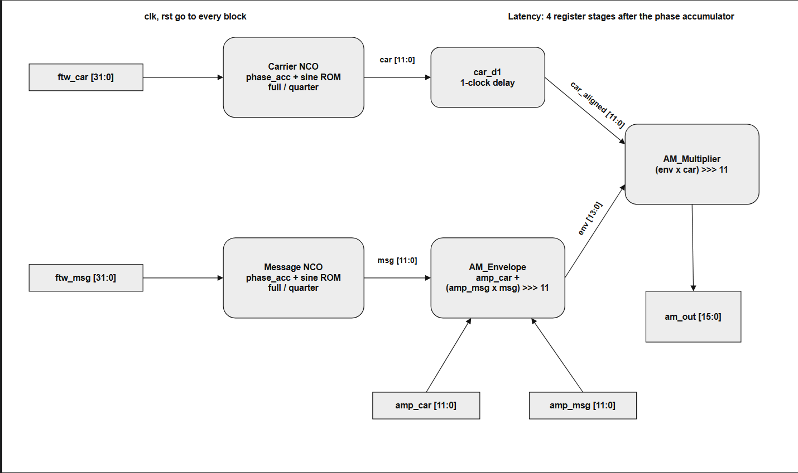

# `am_modulator_top` — datapath, pipeline and fixed-point notes

`am_modulator_top.v` connects two NCOs, the envelope generator and the multiplier, and adds one register of its
own: `car_d1`, a one-clock delay on the carrier. Everything else is in the sub-modules, which are used unchanged.



## 1. Signal flow

```verilog
nco          u_car (.ftw(ftw_car), .sine(car));      // carrier,  2 ROM stages
nco          u_msg (.ftw(ftw_msg), .sine(msg));      // message,  2 ROM stages
always @(posedge clk) car_d1 <= rst ? 0 : car;       // carrier waits for the envelope
am_envelope  u_env (.msg(msg), .amp_car(amp_car), .amp_msg(amp_msg), .env(env));
am_multiplier u_mul (.env(env), .car(car_d1), .am_out(am_out));
```

The envelope is registered, so `env` is one clock behind `msg`. Without `car_d1` the multiplier would combine
the envelope of sample *n* with the carrier of sample *n* + 1. The output would still look like AM, but every
sample would be wrong by a one-sample phase error, and the bit-exact comparison catches that immediately.

## 2. Pipeline and the 3-sample offset

Counting the rising edges after reset is released as *i* = 0, 1, 2, ..., each register holds:

| Register | Value after rising edge *i* | Stage |
|---|---|---|
| `phase` (in `phase_acc`) | phase index *i* + 1 | accumulator |
| `sample_stage1` (ROM) | `rom[phase[i]]` | ROM stage 1 |
| `sine` (ROM) = `car`, `msg` | phase index *i* − 1 | ROM stage 2 |
| `env`, `car_d1` | phase index *i* − 2 | envelope |
| `am_out` | phase index *i* − 3 | multiplier |

So the testbench sample taken after edge *i* equals golden sample *i* − 3. All testbenches and Python tools drop
the first **3** samples and then compare with no further shifting.

There are four register stages after the phase accumulator, yet the offset is 3, because `phase[0]` (the reset
value 0) already sits at the ROM input while reset is held. The ROM registers have no reset, so during reset
they fill with `rom[phase[0]]`. That is why the warm-up samples are not all zero (for the default case they read
`0, 24, 24`) and why they must be discarded rather than compared.

## 3. Fixed-point format

| Signal | Width | Format | Range |
|---|---|---|---|
| `car`, `msg` | 12 | signed Q11 | [−2047, 2047] |
| `amp_car`, `amp_msg` | 12 | unsigned integer | [0, 4095] |
| `msg_term` | 14 | signed | [−4094, 4093] |
| `env` | 14 | signed | [−4094, 8188] |
| `am_out` | 16 | signed | \|am_out\| < 2¹⁴ |

Both products are shifted right by 11 bits (`DW − 1`) with `>>>`, i.e. floor division by 2048. The result is

$$
\text{am\_out} \approx \left(\text{amp\_car} + \text{amp\_msg}\cdot\frac{\text{msg}}{2048}\right)\cdot\frac{\text{car}}{2048}
= \text{amp\_car}\left[1 + \mu\,\hat{m}\right]\hat{c}
$$

with $\hat{m}, \hat{c} \in [-1, 1)$ the normalized sine samples and $\mu = \text{amp\_msg}/\text{amp\_car}$.

### Why the signed cast matters

```verilog
wire signed [2*DW:0] mult = $signed({1'b0, amp_msg}) * msg;
```

In Verilog an expression is signed only if **every** operand is signed. `amp_msg` is an unsigned port, so
`amp_msg * msg` would be evaluated as unsigned and every negative message sample would turn into a large positive
number. Prepending `1'b0` and casting keeps the amplitude positive while making the multiply signed. Removing the
cast was simulated: `tb_am_top` fails four of its seven checks, with the first mismatch at sample 2501, where the
message first goes negative.

### Why nothing can overflow

`tests/test_datapath_ranges.py` checks every `amp_msg` from 0 to 4095 against the table minimum and maximum and
both limits of `amp_car`. Each stage is monotonic in its inputs, so these corners bound every legal input:

- `env` reaches at most 4095 + 4093 = 8188 and at least 0 − 4094 = −4094, inside the 14-bit range.
- `am_out` stays below 2¹⁴ in magnitude, one bit below the 16-bit limit.

No saturation logic is therefore needed. Regression case `edge_amp_max` (`amp_car = amp_msg = 4095`) and
`edge_dsb_max` (`amp_car = 0`, `amp_msg = 4095`) exercise the two extremes in simulation.

## 4. Sine tables and the quarter-wave ROM

```
rom[k] = round(2047 · sin(2π (k + 0.5) / 2^AW))
```

The half-sample offset makes the table symmetric about its quarter points, so the second quarter is the first one
read backwards, and the second half is the first half negated. `sine_rom_quarter` uses that:

| `addr[AW-1]` | `addr[AW-2]` | Quadrant | ROM address | Output |
|---|---|---|---|---|
| 0 | 0 | 0 to 90° | `addr[AW-3:0]` | `+rom` |
| 0 | 1 | 90 to 180° | `~addr[AW-3:0]` | `+rom` |
| 1 | 0 | 180 to 270° | `addr[AW-3:0]` | `−rom` |
| 1 | 1 | 270 to 360° | `~addr[AW-3:0]` | `−rom` |

The sign bit is delayed one stage (`sign_stage1`) so that it meets the sample it belongs to, which keeps the
quarter ROM at the same two-clock latency as the full ROM. `gen_sine_rom.py` checks the reconstruction at every
address for AW = 8, 10 and 12, and regression cases 9, 11 and 13 confirm it in RTL.

## 5. Frequency and phase

$$
f_\text{out} = \frac{\text{FTW}\cdot f_\text{clk}}{2^{32}}, \qquad \Delta f = \frac{100\ \text{MHz}}{2^{32}} \approx 0.023\ \text{Hz}
$$

Only the top `AW` bits of the 32-bit phase address the ROM. The discarded `32 − AW` bits are the source of the
phase-truncation spurs that set the SFDR: about 6 dB per address bit (48.1, 60.7 and 71.9 dB for AW = 8, 10, 12).

Edge cases worth knowing:

| FTW | Behaviour |
|---|---|
| 0 | Phase never moves, `car = rom[0] = 25`, `am_out` is a scaled copy of the envelope |
| 2³¹ (f_s/2) | ROM reads only addresses 0 and 2^(AW−1), values ±25: tiny output, the Nyquist limit |
| 2³² − 1 | Phase decreases by 1 per clock, the carrier is effectively frozen at `rom[2^AW − 1] = −25` |
